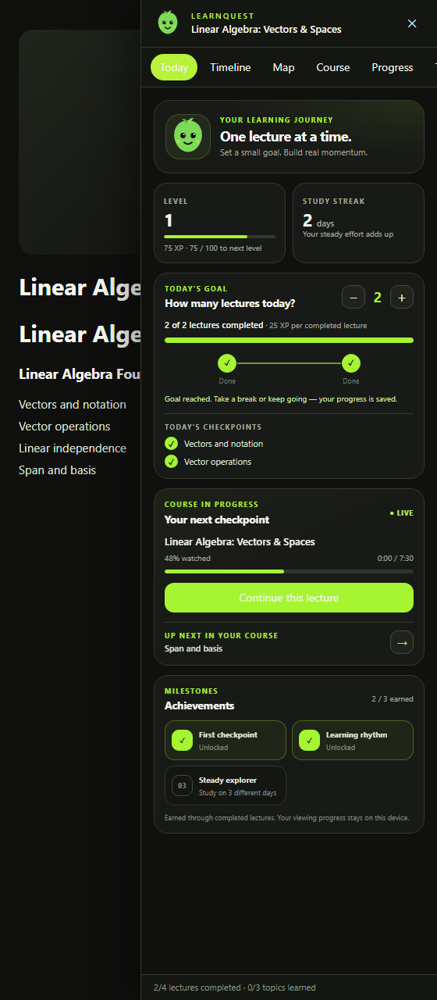
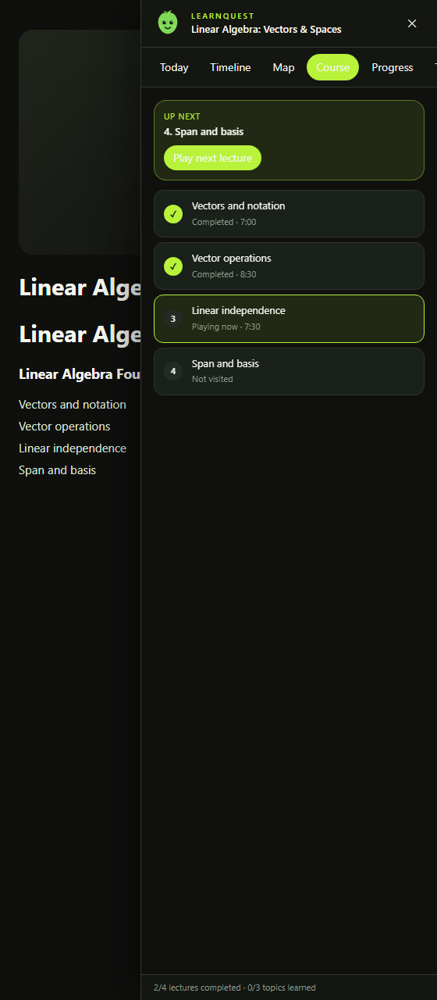

# LearnQuest — YouTube Learning Chrome Extension

**A Chrome extension for YouTube lecture and playlist study, with topic timelines, learning maps, and daily study goals.**

LearnQuest is a YouTube study companion for students who want to follow educational videos without leaving the YouTube player. It adds a clickable lecture timeline, a course learning map, playlist progress tracking, transcript import, and gamified daily study goals.

## Install in Chrome (no coding required)

You do not need to use a terminal, install programming tools, or build the extension. You only need Google Chrome and the downloaded LearnQuest folder.

1. **Download LearnQuest:** [Download the ZIP file](https://github.com/rohansachinpatil/learnquest/archive/refs/heads/main.zip). Save it to your computer.
2. **Unzip the download:**
   - **Windows:** Open your Downloads folder, right-click the ZIP file, choose **Extract All**, then choose **Extract**.
   - **Mac:** Open your Downloads folder and double-click the ZIP file.
   - **Other computers:** Use the computer's built-in archive tool to extract the ZIP.
3. **Open Chrome's extensions page:** Type `chrome://extensions` in Chrome's address bar and press Enter.
4. **Turn on Developer mode:** Find the **Developer mode** switch near the top-right of the page and turn it on.
5. **Load LearnQuest:** Select **Load unpacked**. In the folder picker, open the extracted `learnquest-main` folder and select the folder that directly contains `manifest.json` and `content.js`. Then click **Select Folder** (or **Open**, depending on your computer).
6. **Finish:** Leave the extension enabled, open or refresh a YouTube lecture, and look for the floating **LearnQuest** button near the lower-right of the video page.

> **Why Developer mode?** LearnQuest is currently installed from this GitHub download rather than the Chrome Web Store. Chrome may show a Developer mode notice; this is expected for a manually installed extension.

### If Chrome cannot load the folder

You may have selected the ZIP file or the wrong folder. Go back to **Load unpacked** and select the extracted folder where `manifest.json` is visible. Do not select the `docs` or `screenshots` folder.

> Screenshots use a local sample playlist to demonstrate the interface. Their titles and progress are example data, not claims about a real lecture.

## Screenshots

<table>
  <tr>
    <td align="center">
       
      <strong>Today</strong> · Daily goal and achievements
    </td>
    <td align="center">
       
      <strong>Course</strong> · Playlist progress and next lecture
    </td>
  </tr>
</table>

Select a screenshot to view it at full size.

## Start studying on YouTube

1. Open a YouTube lecture or a video in a playlist.
2. Select the floating **LearnQuest** button near the lower-right of the YouTube page.
3. Open **Today** and use `−` or `+` to set how many lectures you want to complete today.
4. Watch as usual. LearnQuest saves your progress and updates checkpoints as lectures are completed.

Use **Timeline** to jump to a topic, **Map** to explore the learning path, and **Course** to see playlist progress and the next lecture.

## Features for YouTube study

- **Lecture timeline:** Jump to YouTube chapters, timestamped description entries, or topics from a transcript.
- **Learning map:** Explore lecture topics alongside the course playlist and see which topics are learned, current, or upcoming when source data supports it.
- **YouTube playlist tracker:** View available playlist lectures, current and next videos, and saved viewing progress.
- **Transcript import:** Build a more detailed timeline from an `.srt`, `.vtt`, or timestamped text transcript you provide.
- **Daily study goals:** Choose a target of 1–8 completed lectures and follow visual checkpoints during your study session.
- **XP and achievements:** Earn 25 XP for a completed lecture, progress through 100-XP levels, and unlock milestones from recorded study activity.
- **Local progress tracking:** Keep lecture, playlist, goal, and achievement data in this browser using `chrome.storage.local`.

## Set a daily lecture goal

1. Open **Today** in the LearnQuest panel.
2. Use `−` and `+` to set how many lectures you want to complete today.
3. Watch normally. LearnQuest counts a lecture after at least 90% of its duration is watched, or when the video ends. Seeking past a lecture by itself does not count.
4. Follow the checkpoints and see your goal progress, XP, and achievements update.

Streaks are informational. There is no penalty for taking a break, and you can change your goal at any time.

## How the YouTube timeline and transcript work

LearnQuest uses available YouTube chapters and timestamped description entries first. It can also observe captions while they are visible during playback. If a video has no usable topic data, import your own `.srt`, `.vtt`, or timestamped text file from **Transcript**.

LearnQuest does not download transcripts from unofficial YouTube endpoints. Caption and chapter availability varies by video, and playlist entries may be missing when videos are private, unavailable, or not yet rendered on the page.

## Privacy

LearnQuest runs on YouTube pages and requests the `storage` permission for local learning progress. It does not require registration, send transcripts to an AI service, or transmit browsing history to a backend.

## Troubleshooting

- **LearnQuest button is missing:** Check that the extension is enabled, open `https://www.youtube.com/`, and refresh the page.
- **Playlist is not detected:** Open a video from the playlist and wait for YouTube's playlist entries to load.
- **No topic timeline appears:** Check for chapters, enable available captions while watching, or import a timestamped transcript.

## Questions

**Does LearnQuest replace the YouTube player or interrupt playback?**

No. LearnQuest adds a small in-page panel; YouTube remains the video player.

**Does LearnQuest automatically fetch every transcript?**

No. Transcript availability depends on the video. Use visible chapters or captions when available, or import a transcript file you already have.

**Does LearnQuest use an AI backend?**

No. This MVP uses available page information and deterministic processing. No AI API key or external service is required.

**Where is my study progress saved?**

In Chrome's local extension storage on this browser. It is not synced to an account.

## Report an issue

If something does not work, [open a GitHub issue](https://github.com/rohansachinpatil/learnquest/issues) with the Chrome version, the page type (video or playlist), and steps to reproduce. Do not include private account information.

## License

LearnQuest is licensed under the [MIT License](LICENSE).

---

Developed by <a href="https://www.linkedin.com/in/rohansachinpatil/">Rohan Patil</a> · Licensed under MIT

